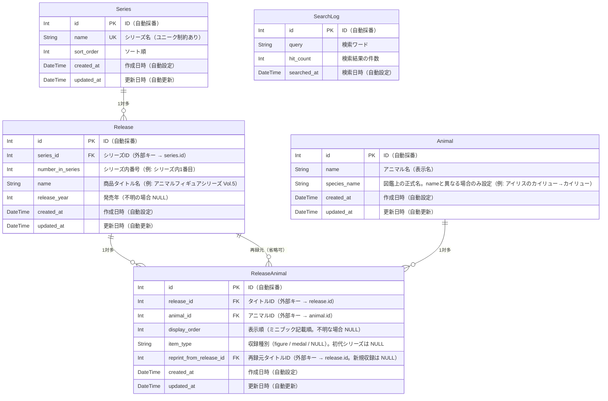

# ER図

---

## テーブル定義

### series（シリーズマスタ）

| 物理名     | 論理名     | 型       | 主キー | 備考               |
|-----------|-----------|---------|:------:|--------------------|
| id        | ID        | Int     | ✓      | 自動採番            |
| name      | シリーズ名 | String  |        | ユニーク制約あり     |
| sort_order| ソート順   | Int     |        |                    |
| created_at| 作成日時   | DateTime|        | レコード作成時に自動設定 |
| updated_at| 更新日時   | DateTime|        | レコード更新時に自動更新 |

### release（商品タイトルマスタ）

| 物理名            | 論理名         | 型       | 主キー | 備考                     |
|------------------|---------------|---------|:------:|--------------------------|
| id               | ID            | Int     | ✓      | 自動採番                  |
| series_id        | シリーズID     | Int     |        | 外部キー → series.id      |
| number_in_series | シリーズ内番号 | Int     |        | 例: シリーズ内1番目        |
| name             | 商品タイトル名 | String  |        | 例: アニマルフィギュアシリーズ Vol.5    |
| release_year     | 発売年         | Int     |        | 不明の場合 NULL            |
| created_at       | 作成日時       | DateTime|        | レコード作成時に自動設定    |
| updated_at       | 更新日時       | DateTime|        | レコード更新時に自動更新    |

### animal（アニマルマスタ）

| 物理名     | 論理名     | 型       | 主キー | 備考               |
|-----------|-----------|---------|:------:|--------------------|
| id           | ID           | Int      | ✓      | 自動採番                                                                              |
| name         | アニマル名   | String   |        | 表示名。ユニーク制約あり                                                              |
| species_name | 図鑑正式名   | String   |        | name と異なる場合のみ設定。例: "アイリスのカイリュー" → "カイリュー"、"メガゲンガー" → "ゲンガー" |
| created_at   | 作成日時     | DateTime |        | レコード作成時に自動設定                                                              |
| updated_at   | 更新日時     | DateTime |        | レコード更新時に自動更新                                                              |

### release_animal（収録情報・中間テーブル）

| 物理名                    | 論理名           | 型       | 主キー | 備考                                             |
|--------------------------|-----------------|---------|:------:|--------------------------------------------------|
| id                       | ID              | Int     | ✓      | 自動採番                                          |
| release_id               | タイトルID       | Int     |        | 外部キー → release.id                             |
| animal_id               | アニマルID       | Int     |        | 外部キー → animal.id                             |
| display_order            | 表示順           | Int     |        | ガチャガチャのミニブック記載順。不明な場合 NULL     |
| item_type                | 収録種別         | String  |        | "figure" / "medal" / NULL。初代シリーズは NULL      |
| reprint_from_release_id  | 再録元タイトルID  | Int     |        | 外部キー → release.id。新規収録の場合は NULL        |
| created_at               | 作成日時         | DateTime|        | レコード作成時に自動設定                            |
| updated_at               | 更新日時         | DateTime|        | レコード更新時に自動更新                            |

### search_log（検索ログ）

> **目的**：ユーザーが何を検索しているかを匿名で収集し、コンテンツ戦略（ブログ記事のネタ探し・DBの収録データ漏れ発見）に活用する。
> 個人を特定する情報（IPアドレス等）は一切保持しない。

| 物理名      | 論理名       | 型       | 主キー | 備考                                                    |
|------------|-------------|---------|:------:|---------------------------------------------------------|
| id         | ID          | Int     | ✓      | 自動採番                                                 |
| query      | 検索ワード   | String  |        |                                                         |
| hit_count  | ヒット件数   | Int     |        | 0件 = ユーザーが求める情報が不足している可能性を示す      |
| searched_at| 検索日時     | DateTime|        | レコード作成時に自動設定                                 |
